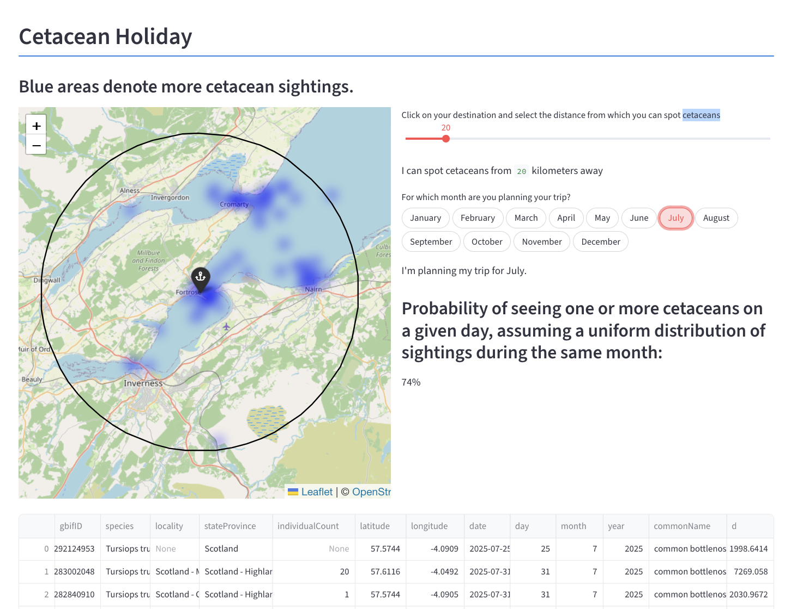

## Cetacean Holiday (What I built and who for)

If you're planning whale- and dolphin-watching for your next holiday, this is for you!

View cetacean sightings statistics for an arbitrary radius around arbitrary coordinates.



## Usage (How to run it)

Tested in Python 3.14  
Requires a free [GBIF](https://www.gbif.org/) account.

```bash
# clone
git clone https://github.com/isklinger/whales_and_dolphins

# set up python virtual environment
cd whales_and_dolphins
python3 -m venv .venv
source .venv/bin/activate
pip3 install -r requirements.txt

# set up credentials
cp gazeteer_credentials.env.example ../gazeteer_credentials.env
# gazeteer - email optional
cp gbif_credentials.env.example ../gbif_credentials.env
# gbif - requires username, password, and email

# extract, transform, load
python3 extract_and_transform/query_api.py
# you will be prompted to wait until you receive an email from GBIF saying the download is ready
python3 extract_and_transform/load.py

# run the app
streamlit run app/streamlit.py
```

## Databases (How it works)

| source | query | credentials requirements | data shaping |
|:-:|---|:-:|---|
|[GBIF](https://techdocs.gbif.org/en/openapi/)|sightings of cetaceans limited by year and polygon|free account|the query provides many columns that aren't used by the marts, so I didn't select them when loading into the local database|
|[Marine Regions]( https://www.marineregions.org/gazetteer.php?p=webservices&type=rest)|(multi-)polygon by name|none|the query provides a multi-polygon, which I converted to a polygon and supplemented with a buffer|

### Freshness and updates

For portability, and so I can have near certainty that the app displays the same results everywhere, the GBIF query selects the years 2020 through 2025 each time. If up-to-date data is required, the query can be optimised in a straightforward way: query for the latest date in the local database, then query GBIF for data from that day onward. If no data is found locally, query GBIF for data from five years ago onward.

As an alternative to freshness checks, local storage can be replaced with live GBIF occurrence-search queries, by querying GBIF each time the user clicks the map. This could create issues with latency and availability of the GBIF API.

The Marine Regions database is queried for the geospatial polygon of the island of Great Britain. This information can be considered immutable within this project's scope and level of precision, and so if a file with the polygon data already locally exists, the local data is used. There are no freshness checks, although these can be implemented by recording the date of the most recent remote query. The polygon may be updated annualy, in case of changes in the island's coastline.

## Data shaping (How it works)

### Extracting and loading:

#### GBIF
- The rows from the GBIF database are generally complete and consistent. There is a unique index for each row.
- I selected rows without geospatial issues using a query parameter for the GBIF API.
- There are clear data sampling artifacts like coordinates arranged neatly along an arc, but this spatial (in)accuracy is sufficiently small for general whale-watching purposes in open seas.
- When the field for "individual count" is empty, the count can be assumed to be one.

#### Marine Regions

- The data from Marine Regions is, for the purposes of this project, completely accurate and correct, or the "ground truth".
- I simplified the polygons returned by the database since they are too detailed to be used with the GBIF API. 

### Transforming:

- The Streamlit app locally queries DuckDB with a coordinate pair generated when the user last clicks on the map.
- DuckDB returns the locally stored GBIF data within the specified radius from the coordinates, which is displayed on the app.
- The app displays the probability of sighting cetaceans in the specified month within the given radius, by the number of distinct days with sightings of one or more cetaceans divided by the number of days in the specified month.
- Duplicate reports of the same sighting do not affect the analysis since it only accounts for days with sightings, not number of sightings or number of individual specimens sighted.

## Possible enhancements (What I would do next)

Performance:

- Refactor the code and implement best practices; this is a messy proof-of-concept.
- Store SQL queries in SQL files, instead of inline with the python code.
- Use dictionaries: the local database doesn't need to contain both scientific name and common name, only the more precise of the two. Similarly, the database can store GBIF taxon codes instead of the scientific name, use district codes for districts, and so on, and look up the codes on app execution, which will optimise database size at a small cost of a minor app runtime dictionary lookup.
- Output the percentage in bigger text, and implement general visual improvements.
- Implement [freshness checks and table-union updates](#freshness-and-updates).
- Implement [duplicate filtering by vicinity in time and space](#transforming) if more fine-grained statistics are required.
- Migrate to dbt.

Features:

- List popular destinations and sort them by count of nearby sightings.
- List nearest city or large town when selecting a coordinate.
- List all months by sighting percentage for a given place and radius.
- Filter sightings by species.
- Show a tooltip when selecting a sighting instance on map, giving details about the sighting.
- Include species outside cetaceans, specifically popular birds and national park wildlife.
- Filter species by activity: birdwatching, boat tour, hiking.
- Provide data about local related business and national parks.

## How this was made

I coded this in Visual Studio Code and vim. I set up a python environment in [a custom Ubuntu container](https://github.com/isklinger/container-image-systemd-ubuntu-xrdp), and tested within the container and on "bare metal" macOS 27. The Streamlit Folium tutorial by Randy Zwitch was used extensively as I have never used Streamlit or Folium before.

### Use of AI (Where AI helped)

No AI was used in the process of researching, coding, and documenting this project. This is an all-natural project.

## Licenses

Tutorials © Stichting DuckDB Foundation  
Released under the [MIT](https://choosealicense.com/licenses/mit/) license

Tutorials © Randy Zwitch, creator of Streamlit Folium  
Released under the MIT license

All other code © Isaac Klinger  
Released under the MIT license

[GBIF - Global Biodiversity Information Facility](https://techdocs.gbif.org/en/openapi/)  
Free and open access to biodiversity data  
Most entries released under the CC-BY-NC 4.0 license, some entries are under less strict licenses.

[Marine Regions](https://www.marineregions.org/gazetteer.php?p=webservices&type=rest)  
A standard list of marine georeferenced place names and areas  
Released under the CC-BY 4.0 license

## About me

Hi, I'm Isaac. I moved to London in early 2025, where I'm living with my wonderful wife who grew up in London.

After attending a meetup at The Data School in mid-2026, I delved deeper into data analysis and dbt. I enjoy the modular and structured "sources, models, tests" design concept of dbt. Its clean design reminds me of the concepts behind python's syntax. I enjoy the visual and technical aspects of data analysis.

I'm employed as a datacenter system administrator for a company based in Soho, keeping installations of Debian, Nginx, Apache, MariaDB, and the sort humming along.
